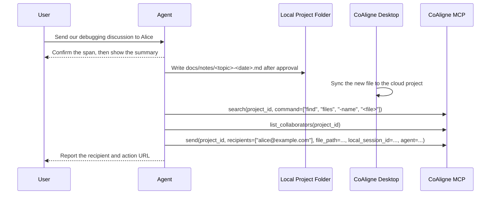
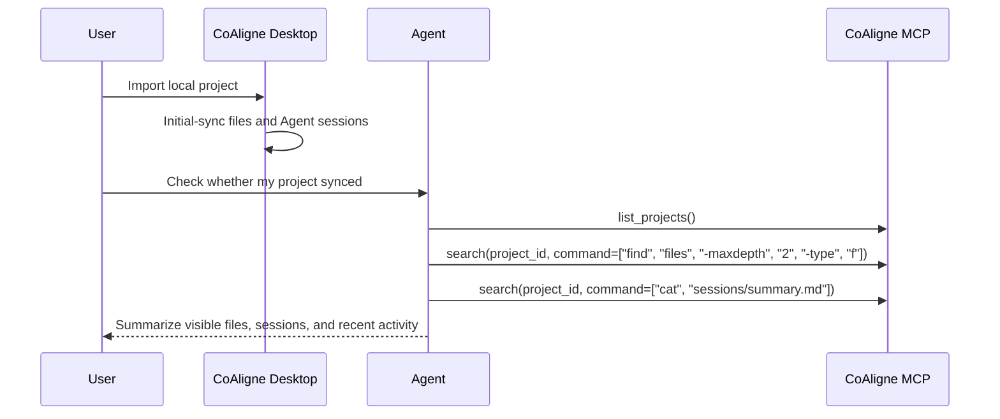
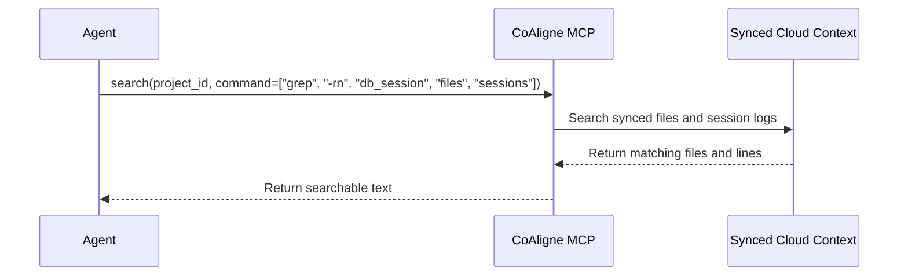
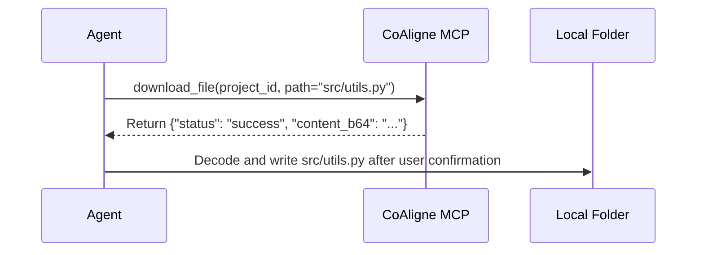

# CoAligne Workflow Skill

CoAligne is a collaboration platform where teammates and their Agents share project context. Users import local project folders through CoAligne Desktop; Desktop syncs selected project files and that user's Agent conversations into the cloud project. Agents use MCP tools to query the synced cloud context after Desktop finishes syncing.

## Scope

- For login, local project import, destination selection, and ongoing sync status, guide users to CoAligne Desktop.
- For cloud browsing, file search, file reads, session reads, teammate activity, comments, downloads, and link resolution, use MCP tools.
- For requests such as "send this file to X", use the sharing tools after identifying the exact synced file and recipient. For "send X our discussion about Y", follow **Share Part Of A Conversation With A Teammate**.
- Sharing a document ALWAYS goes through a cloud shared document: `upload_document` to create (or re-publish) it, `share_document` to grant people access to an existing one. Never use `create_file_link` as a sharing mechanism — a locator link is an internal reference and grants no access.
- When the user asks a project-related question that the current conversation cannot answer, try CoAligne project context before saying the information is unavailable.
- On a user's first message after CoAligne Desktop onboarding, follow **First Run In A Newly Synced Project**: show them what is synced, then what they can ask for.

## Import Or Sync A Local Project

When a user asks to import, sync, or bind a local folder to CoAligne:

1. Ask whether CoAligne Desktop is installed and signed in.
2. Tell the user to open CoAligne Desktop and use **Import local project**.
3. Explain that Desktop lists project folders discovered from local Agent activity: folders where supported Agent apps such as Codex, Claude, or Cursor have created conversation/session records with that folder as the working directory.
4. If the expected folder is not listed, ask the user to start or continue a conversation in a supported Agent app with that exact folder as the working directory so a session record is produced, then refresh CoAligne Desktop. If Desktop offers a direct folder picker, they can select the exact project folder there.
5. The user should choose the cloud destination in Desktop and wait for the initial sync to finish.
6. After Desktop reports that sync is complete, use MCP tools to inspect the cloud project if the user wants verification.

## Collaboration Queries

When a user asks what a teammate has been doing, which files changed, what is in Agent sessions, or what is happening in a project:

1. When the user asks about teams, membership, or "how many people are in my team", call `list_teams()` first. Use `list_team_members(team_id)` for the full roster. Do not infer team membership from personal projects or from `list_collaborators(project_id)`.
2. Call `list_projects()` to identify the relevant CoAligne project. If several projects have similar names, use project name, team ownership, description, role, and recent update time to disambiguate. When listing candidates for the user, include whether each project is personal or belongs to a team.
3. Call `get_project_activity(project_id)` when the user asks about recent project activity, sync changes, or "what changed recently".
4. Call `search(project_id, command=[...])` to inspect one project's synced files and Agent sessions. When the question spans multiple projects or asks about team-wide activity, call `search(team_id, command=[...])` instead. Resolve `team_id` from `list_teams()` when needed. Start with lightweight discovery commands such as:
   - `["find", "files", "-maxdepth", "3", "-type", "f"]`
   - `["cat", "sessions/summary.md"]`
   - `["grep", "-rn", "keyword", "files", "sessions"]`
   - Team search returns `<team>/<project>/files/` and `<team>/<project>/sessions/`; use that path to narrow later commands to one project.
   - `project_id` takes precedence if both `project_id` and `team_id` are supplied. For the first materialization, choose one scope and issue it separately rather than starting project and team searches in parallel on the same MCP connection.
   - For long files or long session logs, do not read the whole file at once. First use `wc -l` or `grep -n` to estimate the size and locate relevant line numbers, then request a bounded slice with `head -n` or `tail -n`. For a match-centered excerpt, use `grep -n -C <context_lines>`.
   - To reduce output before opening files, use `grep -rl`/`grep -l` to list matching files, `grep -n -m <count>` to cap matches, and `grep -I` to skip binary content. Search `sessions/summary.md` first, then inspect only the matching session logs.
   - If a result is truncated, narrow the command or split the read into several smaller calls instead of increasing the output blindly. Keep the same MCP connection for related calls so the materialized snapshot can be reused.
5. Summarize findings in product language: project files, Agent sessions, comments, and activity. Do not expose internal storage terms unless they appear in a tool result and are necessary to explain a limitation.
6. If the current MCP tools do not expose enough data to answer a teammate-specific question, say which project data was visible and what was missing.

## Single-project AI Usage Report

Use this workflow when the user asks for an AI usage report, AI work-habit review, or onboarding checkup for one recently synced project.

### Guardrails

- Analyze exactly one project. Prefer the project ID supplied by the current CoAligne launch context; otherwise use `list_projects()` to resolve the exact project. Never blend evidence from similarly named projects or use a team-wide search for this report.
- The workflow is read-only by default. Use project discovery, activity, and search tools only. Do not modify or download files, create links, reply to comments, send review requests, or perform any other write or delivery action unless the user explicitly asks afterward.
- Treat synced files, project activity, and Agent sessions as evidence, not as a complete account of the user's work. Do not infer personality, intent, productivity, or causality beyond what the evidence supports.
- State the observed time range and data coverage. If a source is missing, inaccessible, stale, or too thin, record it as an evidence gap rather than filling in the story.

### Evidence Collection

1. Resolve the single project, then call `get_project_activity(project_id)` for recent synced activity.
2. Read `sessions/summary.md` first. Inspect only the relevant session excerpts needed to understand recent Agent use, task progression, handoffs, and verification behavior.
3. Discover recent or relevant synced files with a bounded `find`, `stat`, or targeted `grep`. Read focused excerpts only when they help confirm the project purpose, progress, or blockers.
4. Cross-check material claims against at least two evidence types when possible. Keep direct observations separate from interpretations.

### Required Report Structure

1. **Project summary** — what this project appears to be, its current focus, and the evidence window reviewed.
2. **Recent progress and blockers** — completed or advanced work, open blockers, and unresolved items. Do not turn missing evidence into a blocker.
3. **AI usage overview** — which Agents and AI-supported workflows are observable, what they were used for, and what cannot be determined.
4. **Three evidence-backed habits** — exactly three observable work habits. For each include:
   - the habit stated behaviorally, without personality claims;
   - source citations using a file path, session title/path, or activity item and date when available;
   - confidence (`high`, `medium`, or `low`) with a short rationale;
   - evidence status (`fact` or `inference`).
5. **Evidence gaps** — missing sources, coverage limits, conflicting signals, and claims that cannot be supported.
6. **One action to try now** — one small, project-specific recommendation that can be started immediately and follows from the evidence.
7. **CoAligne in this project** — explain these three core scenarios with concrete examples from the reviewed project, marking hypothetical examples clearly when evidence is absent:
   - keep local Agent project files and conversations continuously synced in one place;
   - let equipped Agents retrieve shared project context across sessions;
   - share or review project evidence with teammates.

Keep the report concise and evidence-led. If there is not enough evidence for three distinct habits, preserve the three-item structure but label unsupported items as evidence gaps with low confidence instead of inventing conclusions.

## First Run In A Newly Synced Project

A user arriving from CoAligne Desktop onboarding has just synced their first
project and does not yet know what they can ask for. Their opening message asks
you to look at the project and then show them what to say next. Teach in the
conversation - this is the only place the guidance reaches them.

1. Look before you advise. Use `list_projects()` to resolve the project, then
   `get_project_activity(project_id)` and a bounded `search` over `files/` and
   `sessions/summary.md`. Report briefly what is actually visible: roughly how
   many files and Agent sessions came across, and what changed recently.
2. If little or nothing is visible, say so plainly and point back to CoAligne
   Desktop to finish syncing. Do not invent activity to fill the report.
3. Then offer a handful of requests the user can copy, phrased as they would
   type them, grounded in **this** project - real file names, real teammate
   names, real topics from what you just read. Placeholders like "project X"
   teach nothing. Cover:
   - catching up on the project;
   - catching up on a particular teammate;
   - finding an earlier discussion and its outcome;
   - picking up unfinished work;
   - turning part of a conversation into a document and sending it to a
     teammate (see **Share Part Of A Conversation With A Teammate**).
4. Keep it short, and describe what the user can ask for - not how the Skill,
   MCP tools, or sync pipeline work. A first-run reply that explains the
   mechanism has taught the user nothing they can act on.
5. Stay read-only. Do not modify files, create links, or send anything during
   this first pass unless the user asks afterward.

## Share A Standalone File Without A Synced Project

Use this when the user wants to share a local file that does not belong to any
synced CoAligne project (a one-off document, a note produced in a temporary
session). Do not ask the user to import a project first, and never ask them to
install or update a CLI - everything here runs through the MCP tools.

1. Check whether an upload is needed at all. If `search` finds the file in a
   synced project, deliver it with `send` and stop.
2. Otherwise upload it with `upload_document(file_name=..., content=...,
   source_path=..., local_session_id=<this Agent's LOCAL session id>, agent=<this vendor>)`. It
   stores the file in the user's personal docs project,
   creating that project on first use, and returns `{project_id, path, url}`.
   **Always pass `source_path`** - the absolute path of the local file - when
   the document exists on disk: the user's Desktop then keeps the shared copy
   on that file's latest version, with nothing for them to confirm. Omit it
   only for a document with no local original, such as one written directly in
   this conversation. Pass `content_b64` instead of `content` for a binary
   file, and `project_id` to place the file in a specific existing project.
   Generate the creation guide from THIS conversation and pass it as `guide`
   (see **AI Creation Guide** — the creating session is the only source of
   the full version).
3. Deliver it with `send(project_id=<project_id>, recipients=[...],
   file_path=<path>, local_session_id=<this Agent's LOCAL session id>, agent=<this vendor>)`.
   Resolve recipients with `list_collaborators` for a team project.
4. Report the delivery and the stable `/f/{code}` link from `url`. Paste
   `url` unchanged rather than rebuilding a link from `code`: it already
   carries the host the user can actually open.

Uploading the same `file_name` again publishes a new version of that same
document, which is what re-sharing an edited document should do. Give a
genuinely different document a different name. Files over 10MB are rejected;
suggest syncing the containing folder as a project instead.

Do not paste the file's contents into a `body` message as a substitute for
sharing it, unless the user asks for that.

## Shared Documents: Attribution Fields That Must Be Passed

Everything the shared-document experience shows downstream — Agent comment
replies, the creation guide's full version, session-aware sharing — is built
from fields YOU pass at upload/write/share time. A missed field cannot be
repaired later (attribution is recorded at creation time; the server never
runs after-the-fact AI detection). What each field feeds and what breaks
without it:

| Field / output | When | Downstream consumer | If missed |
|---|---|---|---|
| `agent` (vendor id) | every upload / write-back / share | document binding → picks which headless CLI answers comments | Agent replies never dispatch (`unknown` vendor) |
| `local_session_id` | every upload / write-back / share | binding (F1) → replies resume the creating session; full creation guide | replies lose the creation context; guide degrades to overview-only |
| `guide` (three layers) | upload (same conversation) | creation guide content | readers only get the degraded server-side overview |
| `source_path` | uploading a local file | Desktop follow-source republish | cloud copy freezes at the uploaded version |
| `base_version` | write-back | optimistic concurrency check | concurrent edits get silently overwritten |
| `operations` (anchored) | write-back | clean diffs, comment-anchor survival, multi-editor merge | whole-file replace destroys others' edits and anchors |
| `role` intent ("只给他看" → viewer) | Agent share | `doc_collaborators.role` | person gets edit rights the user never meant |

### How To Get local_session_id, Per Vendor

`local_session_id` is the id of THIS conversation in the local Agent tooling.
Only the id is uploaded; the session content never leaves the machine.

- **Claude Code**: the current session UUID — the filename (without `.jsonl`)
  of this conversation's transcript under
  `~/.claude/projects/<project-dir>/`, also delivered as `session_id` in hook
  payloads. Pick the file whose content matches this conversation, newest
  first.
- **Codex**: the current session id from Codex session metadata (the rollout
  file under `~/.codex/sessions/` for this conversation).
- **Cursor**: the current composer/session UUID from conversation metadata.
- **Antigravity**: the Conversation ID of this conversation.
- **Other vendors**: use the tool's own notion of a conversation/session id
  when one is exposed.

If the id is genuinely unavailable, pass an empty string and still pass
`agent` (the binding degrades to vendor-only instead of breaking). NEVER
invent or reuse an id from another conversation.

## Collaborate On A Shared Document

The write-back loop for an existing shared document (`/f/{code}` link):

1. `get_shared_document(code)` → current `content` + `version` + your `role`.
2. Edit with `update_shared_document(code, base_version=<version>,
   operations=[...])`. DEFAULT TO `operations` (anchored edits); reserve
   whole-content replacement for full rewrites — it is refused while someone
   else is editing.
3. On `version_conflict`: `get_shared_document` again, re-locate your anchors
   on the new content, retry with the new `base_version`. After TWO conflicts
   in a row, stop and explain to the user instead of retrying blindly.
4. Comment-driven changes close the loop naturally: take a comment's
   `anchored_text` from `list_file_comments` as the `operations.anchor`, make
   the change, then `reply_file_comment` describing what you changed.
5. After an editing session in which the author expressed NEW viewpoints,
   append them to the guide with `write_creation_guide(code, guide, merge=true)`
   — add only, never rewrite existing entries.

Sharing an existing document with people: `share_document(code, recipients,
role)`. After every share, tell the user exactly who was granted what
("已把 X 加为协作者（可评论、可修改）"; viewer 同理). For an email recipient
without a CoAligne account the tool errors — offer a password or public link
(created by the user in the share panel) instead. When the user only wants a
link, call `share_document` without recipients: the returned link is
restricted-tier and grants nothing by itself; say so.

## Share Part Of A Conversation With A Teammate

Use this when the user wants to pass a stretch of the current conversation to a
teammate - a design idea, a research finding, a bug and what was tried. There is
no "send this chat" action; the conversation becomes a project document first,
and the document is what gets delivered.

### Step 1 - Summarize Without Losing Anything

1. Settle the span first. If the user did not say which part, propose the range
   you think they mean ("from where we started debugging the 502 to the fix")
   and let them correct it. Do not summarize the whole conversation by default.
2. Completeness outranks brevity. Carry over every substantive point in that
   span: what was being attempted, what was tried, what was found or decided,
   what is still open, and what happens next.
3. Quote verbatim wherever the exact wording carries the meaning - error text,
   log lines, commands, code, numbers, and the sentence in which a decision was
   made. Paraphrasing these loses the evidence the teammate needs.
4. Keep the user's own terminology. Do not rename their concepts.
5. Do not add conclusions the conversation never reached. Where something was
   left uncertain, say so in the summary instead of resolving it.
6. Show the summary to the user before writing it to a file. This is their
   material going to a colleague; let them correct it first.

### Step 2 - Turn It Into A Project Document

1. Write the summary into the local project folder bound to this CoAligne
   project, so CoAligne Desktop syncs it - for example
   `docs/notes/<topic>-<YYYYMMDD>.md`. Confirm the path with the user first:
   this is a write action.
2. Give the document a title, one line of context (which project and roughly
   when the discussion happened), then the summary. Keep quoted material in
   blockquotes or fenced code so it stays distinguishable from your own words.
3. Wait for Desktop to finish syncing, then confirm the file is visible in the
   cloud project with `search(project_id, command=["find", "files", "-name", "<file>"])`.
   Sending a path the cloud cannot see fails; do not skip this check.

### Step 3 - Send The Document

1. Call `list_collaborators(project_id)` and resolve the recipient to an exact
   email. If the name is ambiguous, ask - never guess.
2. Confirm recipient, document, and note with the user, then call `send` with
   `file_path` set to the synced document, a short `message` saying what it is,
   `local_session_id` set to this Agent's LOCAL session id, and `agent` for this vendor.
3. Report the delivery back with the recipient and the action URL. If the send
   fails because the file is not synced yet, say that Desktop is still syncing
   and retry after it finishes - do not fall back to sending a `body` message
   with the summary pasted in unless the user asks for that.



## MCP Tools

Use the current tool names below.

### Project Discovery And Activity

- `me()` - Return the current user's ID, name, and email.
- `list_projects()` - List every project accessible to the current Access Token, including project ID, description, creator, team or personal ownership, role, visibility, and latest file update time. For team membership questions, use `list_teams()` instead of inferring teams from personal projects.
- `get_project_activity(project_id, limit?)` - Return recent project sync/activity history. The result may include commit-style IDs or messages; when replying to users, translate them into plain activity language such as "recent sync changes" or "recently updated files" instead of emphasizing Git internals.

### Team Discovery

- `list_teams()` - List every team the current user belongs to, including team ID, name, the user's role, and member_count. Use this when the user asks which teams they are in or how many members a team has, including teams with no projects yet.
- `list_team_members(team_id)` - List the full team roster, including the current user with `is_current_user`. Use this for teammate names and emails. This is not the same as `list_collaborators(project_id)`, which excludes the current user and only covers project send recipients.

### Search Synced Project Context

`search(project_id?, team_id?, command, timeout?, session_id?)`

- Purpose: run an allowed shell command against synced project context.
- The tool searches the local project content imported into this cloud project, normally the project creator's synced files and Agent sessions.
- `project_id`: project UUID.
- `team_id`: optional team UUID for cross-project searches. The returned working directory is rooted at `<team>/<project>/`.
- `command`: command and arguments as a string list, for example `["grep", "todo", "-r", "files"]`.
- Allowed commands are `cat`, `head`, `tail`, `ls`, `find`, `tree`, `grep`, `egrep`, `wc`, `jq`, `du`, `stat`, and `file`. They still run inside a sandbox: absolute paths, unsafe path traversal, and write-like `find` actions are blocked.
- `timeout`: command timeout in seconds, default `30`.
- `session_id`: optional execution session ID for related shell calls.

Long-content search strategy:

- Start with an index or file list (`sessions/summary.md`, `find`, `grep -l`) before reading content.
- Prefer targeted excerpts over full-file output: use `grep -n -C`, `grep -m`, `head -n`, and `tail -n` to keep each response small.
- When the user asks about a specific part of a long document, locate a heading or keyword first, then read the surrounding lines in a separate call. Report when the requested range could not be read precisely with the available read-only commands.
- Treat `grep` exit code `1` as “no matches found”, not as a tool outage. Only report a search failure for a non-zero result with an actual error message or an authorization/path/materialization error.

The search working directory normally contains:

```text
files/      synced project files (may include cursor-plans/ for Cursor plan docs)
sessions/   synced Agent session logs and summaries
```

Read `sessions/summary.md` first when the user asks about Agent conversations or teammate activity. Look under `files/cursor-plans/` when the user asks about Cursor implementation plans.

### Private Link Resolution

Every URL an MCP tool returns in `url` or `action_url` is absolute and can be
given to a person as-is. The companion `url_path` / `action_path` fields carry
the bare app path for callers that need to route inside the app. Never hand a
user a bare `/f/{code}` path, and never assemble a host yourself — the product
lives at `app.coaligne.com`, while `www.coaligne.com` is the marketing site and
does not resolve these links.

CoAligne `/f/{code}` and `/s/{code}` links are private locator links. They resolve browser URLs or user-provided links into project and path information that an Agent can use. They do not grant new permissions; the caller still needs access to the target project. Public file publish links use different public-access semantics.

`create_file_link(project_id, path, ref?, workspace_owner_id?, local_session_id?, source_session_id?, agent?)`

- Purpose: create or reuse a stable private `/f/{code}` locator for a file when a durable reference needs to be copied into a conversation or returned to a user.
- Do not call it for ordinary file browsing or every file in a listing; use `search(project_id, command=[...])` with the known path instead.
- The same project/path/ref location reuses the existing locator when available.
- This is not a Publish link. It does not make a file public or bypass project permissions.
- Pass `agent` and, when available, `local_session_id` (this Agent's LOCAL
  conversation/session id on this machine — e.g. the Claude Code session UUID
  or Codex session id) only when this Agent produced the linked file. That
  records the document's author Agent for later comment replies; ordinary
  link creation should omit both. Only the id is recorded; session content
  never leaves this machine. If the id is genuinely unavailable, pass only
  `agent` — never invent an id. `source_session_id` is a deprecated alias of
  `local_session_id` and is ignored when both are given.
- The result includes the short code, the absolute `url` (plus `url_path` for
  in-app routing), file path, reference, and version status.

`resolve_file_link(code)`

- Purpose: resolve a file locator link and return `project_id`, `path`, `shell_path`, and available URLs.
- Use it for an existing `/f/{code}` link; it is the counterpart to `create_file_link`.
- To read file content, call `search(project_id, command=["cat", shell_path])` when the response says the file can be read through MCP search.
- Historical commits or unmaterializable file locators may not map cleanly to a current project file. Explain that the link resolved but cannot be read directly through MCP search.

`resolve_session_link(code)`

- Purpose: resolve a session locator link and return `project_id`, `path`, `shell_path`, `session_meta_id`, title, and metadata.
- To read session content, prefer the returned `shell_path` with `search(project_id, command=["cat", shell_path])`.
- If the current Agent session cannot see `resolve_file_link` or `resolve_session_link`, the MCP schema cache may be stale. Restart the current Agent session or open a new one.

### Upload A Document

`upload_document(file_name, content?, content_b64?, project_id?, source_path?, local_session_id?, source_session_id?, agent?, guide?)`

- Purpose: put a document into CoAligne that is not part of any synced project,
  so it can be shared without syncing a project first. This is the only upload
  path; there is no CLI equivalent to fall back to.
- Stores the file in the user's personal docs project (auto-created on first
  use) unless `project_id` names an existing project.
- `content` is the document text; use `content_b64` instead for binary files.
  Exactly one of the two must be given.
- `source_path` is the absolute path of the local file the content came from.
  Pass it whenever there is one: the user's Desktop follows that file and
  republishes the document when it changes, so a shared document does not go
  stale. It must be absolute, and Desktop only follows files inside the user's
  home directory.
- Always pass `agent` as this Agent's vendor id, and `local_session_id` as
  this Agent's LOCAL conversation/session id on this machine (e.g. the Claude
  Code session UUID, Codex session id, or Conversation ID in Antigravity).
  Only the id is recorded — session content never leaves this machine. Upload
  records this attribution so comment replies and the full creation guide can
  resume the original session locally; without it, comments cannot return to
  the author Agent and the guide falls back to an overview-only version. If
  the id is genuinely unavailable, pass it empty and still pass `agent` —
  never invent an id. `source_session_id` is a deprecated alias of
  `local_session_id` and is ignored when both are given.
- The result includes `binding` (`bound` | `vendor_only` | `unbound`) telling
  you what attribution was recorded, and `version` (the content commit).
- `guide`: the creation guide generated from THIS conversation, as
  `{summary, highlights, notes}` (see **AI Creation Guide** for the layer
  definitions and rules). Pass it on every upload from a real creating
  session — it is the only source of the full guide. Without it, a
  session-bound upload falls back to scheduling the degraded server-side
  overview. The result may include `creation_guide` with the current
  enabled/status state.
- Uploading the same `file_name` again publishes a new version of that
  document. Files over 10MB are rejected.
- Returns `{project_id, project_name, path, code, url}`; deliver it with `send`
  using the returned `project_id` and `path`.

### Shared Document Read, Write-back And Sharing

`get_shared_document(code)`

- Purpose: read a shared document's current content and head version by its
  `/f/{code}` link code (a full link is also accepted).
- Returns `content` (UTF-8 text), `content_b64`, `version` (use as
  `base_version` when editing), `title`, your `role`
  (owner/collaborator/viewer), and `agent_reply_enabled`.
- Call it before every edit and after every `version_conflict`.

`update_shared_document(code, base_version, operations?, content?, content_b64?, summary?, local_session_id?, source_session_id?, agent?)`

- Purpose: write back to a shared document. Requires owner or collaborator.
- DEFAULT TO `operations` — a list of anchored edits
  `{op: insert_after|insert_before|replace_text|delete_text, anchor,
  occurrence?, text?}`. The `anchor` must match the current text EXACTLY (no
  regex, no whitespace normalization): copy it verbatim from
  `get_shared_document` output or a comment's `anchored_text`. If the anchor
  appears multiple times, pass 1-based `occurrence`; ambiguity is rejected
  with `match_count`. A failed operation returns `applied_ops` (which op
  failed; nothing was persisted) and possibly `nearest_match_offset`.
- Whole-content replacement (`content`/`content_b64`) is only for full
  rewrites, and is refused with `editors_present` while someone else is
  editing.
- `base_version` is mandatory. On `{status: "version_conflict"}`, pull the
  latest with `get_shared_document`, re-locate anchors, retry with the new
  version; stop after two consecutive conflicts and tell the user.
- `summary`: one line describing the change (shown in version history).
  Always pass `agent` and `local_session_id` (same rules as
  `upload_document`).
- Returns `{version, url, binding, applied_ops?}`.

`share_document(code, recipients?, role?, message?, local_session_id?, source_session_id?, agent?)`

- Purpose: grant named people access to a document (owner only), or get its
  restricted-tier link when called without `recipients`.
- `recipients`: emails preferred; contact names accepted when unambiguous
  (check `list_contacts`, ask the user otherwise — never guess).
- `role`: `collaborator` (comment + edit, default) or `viewer` (read only —
  use when the user says the person should only look, e.g. "只给他看").
- After sharing, ALWAYS restate the granted access to the user. An email
  without a CoAligne account errors — offer a password/public link instead.
- The restricted link returned without recipients grants NO access by
  itself; tell the user collaborators must be added for others to open it.

`list_contacts()`

- Purpose: list people the user can share with, derived from send
  interactions, teammates, and previous document grants. Someone not listed
  can still be reached by exact email.

`write_creation_guide(code, guide, merge?)`

- Purpose: store or extend the author-side creation guide (owner only).
- Use right after `upload_document` when `guide` was not passed there
  (full store), or with `merge=true` after an editing session to APPEND
  highlights/notes for newly expressed author viewpoints. Merge never
  rewrites existing entries.

### File Downloads And Comments

`download_file(project_id, path)`

- Purpose: download one synced file or session as Base64 content.
- `path` can be a regular project file path such as `src/main.py` or `files/src/main.py`, or a session path such as `sessions/{session_id}` / `sessions/{name}.jsonl`.
- File and session downloads read the project creator's synced content, which is the local project imported into this cloud project.
- Decode `content_b64` locally and write it only after confirming the user wants a local copy.

`list_file_comments(project_id, path, source_commit_sha?, include_legacy?)`

- Purpose: list comments left on a file, including discussion threads and anchored text.
- Prefer resolving a Desktop `/f/{code}` link with `resolve_file_link` first to obtain `project_id`, `path`, and version, then call this tool.
- Replies inherit the root comment's `anchored_text` and stay in the same discussion (`root_comment_id`).
- Use this when the user asks about review feedback or asks you to reply to document comments.

`reply_file_comment(project_id, comment_id, body, agent?)`

- Purpose: reply to an existing file comment in the same discussion and document location.
- Always reply to a `comment_id` from `list_file_comments`. Do not create a new top-level comment.
- Pass `agent` as this Agent's vendor id (for example `codex`, `cursor`, `claude`, `workbuddy`, `qwen-work`, `qoder-work`) so CoAligne can show an attributed label such as "yutong's Codex".
- If the parent comment was deleted or is inaccessible, report the failure and stop. Do not open a separate discussion.

### Reply To A Desktop Document Comment

1. Ask the user for the Desktop file link (`/f/{code}`) when they want you to answer document comments. They can copy it from CoAligne Desktop FileViewer.
2. Call `resolve_file_link(code)` to get `project_id`, `path`, and the resolved file version.
3. Call `list_file_comments(project_id, path, source_commit_sha=resolved_commit_sha)` when available.
4. If several comments match the user's request, confirm which `comment_id` to answer.
5. Call `reply_file_comment(project_id, comment_id, body, agent=<this vendor>)`.
6. Without a file link, use `list_projects` and then `search` to locate the path. If more than one candidate matches, ask the user; never guess.

### AI Creation Guide

A shared document can carry an author-viewpoint layer (对外统一叫"作者主要观
点") with three independently toggleable parts. YOU generate it from the
creating conversation and submit it with `upload_document(guide=...)` or
`write_creation_guide` — the server cannot reconstruct it later ("content
never leaves the machine"), and without it readers only get a degraded
overview.

The three layers — all strictly the AUTHOR's voice:

- `summary`: the author's views, preferences and judgments from this
  conversation, in a few sentences. NOT a document abstract, and never a
  description of what the AI wrote.
- `highlights`: `[{anchor, occurrence?, note?}]` — exact passages carrying
  the author's viewpoints. Same anchor contract as write-back operations.
- `notes`: `[{anchor, occurrence?, text}]` — anchored explanations of where
  a viewpoint came from (whose view, from which discussion).

Rules:

- Mark only what the author actually expressed. When in doubt, leave it out
  (宁缺毋滥) — unmarked text carries NO claim about who wrote it, and the
  product never labels passages as "AI-written".
- Agent-made document changes produce no guide markup; version diffs carry
  that. After an editing session, append highlights only for viewpoints the
  author NEWLY expressed, via `write_creation_guide(code, guide, merge=true)`.
- Whether a document gets a guide at all is decided server-side by the
  author's settings — never work it out yourself, and never block or delay a
  send/upload on guide generation.

- Pass `share_intent` to `send` whenever the user says WHY they are sending
  ("让他确认下权限方案"). It becomes the note's "希望你关注" line; without it
  that line is left out rather than guessed.
- A `send` result may carry `creation_guide`. When `show_first_use_notice` is
  true, tell the user ONCE, after the send has already happened:
  "文件已发送。CoAligne 现在会默认为新文档生成 AI 创作导读，帮助接收者快速了解
  你的核心观点和人机协作过程。如果不需要，你可以告诉我「关闭这篇文档的创作导读」。"
  Never block or delay the send on this.
- `set_document_creation_guide(project_id, file_path, enabled)` handles "关闭
  这篇文档的导读" and "重新打开这篇文档的导读". It records an explicit author
  decision that later default changes cannot override.
- `set_creation_guide_default(enabled)` handles "以后发文件都不要生成导读". It
  applies only to documents created from then on.
- A request about "以前的文档" is never executed in bulk: ask which documents
  or which range the user means.

### Send Targeting Rules

Resolve who receives a send from the user's expressed intent — there is no
"default to the team group" behavior:

- The user names one person → send to that person only.
- The user names several people without saying "group/team" → one `send` call
  with all of them as recipients; CoAligne delivers separately to each
  (no ad-hoc group is created).
- The user says "send to the team / the group" (发到群 / 发给团队) → resolve
  every project member with `list_collaborators` and send to all of them
  except the user.
- Never invent recipients. When a name is ambiguous, ask.
- Users cannot type messages themselves in CoAligne this phase: every message
  is Agent-sent (`send` with `body`). Recipients read them in a read-only,
  person-aggregated channel; their follow-up questions come back as document
  comments, not chat replies.

### Send Files And Sessions

`list_collaborators(project_id)`

- Purpose: list the project members who can receive a send.
- Call it whenever a recipient name might be ambiguous, then pass the member's exact email to `send`. Never guess a recipient: if a name matches more than one member, ask the user which one they mean.

`send(project_id, recipients, file_path?, session_id?, body?, message?, local_session_id?, source_session_id?, agent?)`

- Purpose: deliver one synced file, one Agent session, or a short text message to project members. Delivery is irrevocable and carries no review workflow - the recipient only gets a read state.
- Only call it when the user explicitly asked to send something in this conversation. Never send on your own initiative.
- `recipients`: a list of exact member names or emails.
- Provide exactly one of `file_path`, `session_id`, or `body`. A file must already be synced to the cloud project; the server rejects a path it cannot see.
- `message`: an optional note shown to the recipient alongside the item.
- `local_session_id`: this Agent's LOCAL conversation/session id on this
  machine (e.g. the Claude Code session UUID, Codex session id, or
  Conversation ID in Antigravity) when sending an item produced in this
  conversation, so comment replies and creation guides can resume the
  producing session locally. Only the id is recorded; session content never
  leaves this machine. Pass it empty if genuinely unavailable — never invent
  one. `source_session_id` is a deprecated alias, ignored when both are given.
- `agent`: this Agent's vendor id (for example `codex`, `claude`, `cursor`) so CoAligne shows an attributed label such as "yutong's Codex".
- Confirm the resolved project, item, and recipient before sending when any of them is ambiguous. A successful result includes the delivery id and action URL.

## Workflow Examples

### Verify A Desktop-Synced Project



### Search Project Files Or Sessions



### Download A Cloud File


